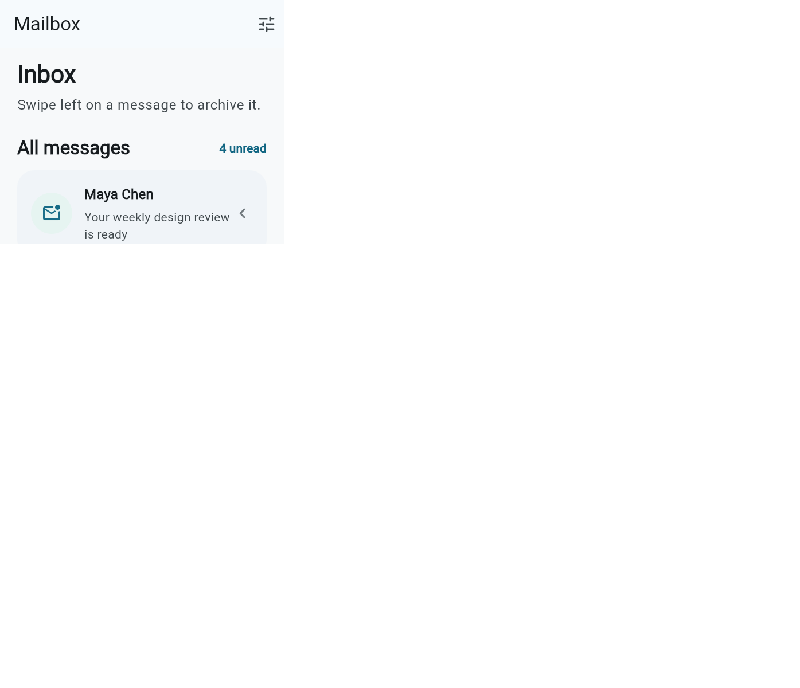

# Mailbox

`Dismissible` lets users archive messages by swiping them away from a mailbox.

## Real-world use case

This is a small email mailbox. A user can swipe a message after reading it,
see an archive action revealed underneath, and undo the action from the
SnackBar if it was accidental. Swipe behavior is configured from the
settings icon, like a regular mail app.

## Run the project

1. Install Flutter 3.44.6 or a compatible stable release.
2. Clone this repository and open its folder.
3. Run `flutter pub get`.
4. Start the app with `flutter run` or choose Chrome/Windows in VS Code.
5. Swipe a message left to archive it. Open the tune icon to adjust swipe
   preferences.

## Exactly three `Dismissible` properties

Open **Swipe preferences** from the tune icon to change each selected property.
The values shown in parentheses are the Flutter defaults.

1. **`direction`** (`DismissDirection.horizontal`) controls which direction
   can dismiss the child. The mailbox starts with `endToStart` so a left swipe
   matches the conventional archive gesture. Change it to `horizontal` to
   allow either left or right swipe.
2. **`background`** (`null`) is the widget revealed behind the child while it
   moves. The mailbox displays a green archive background; change it to `null`
   to see the message slide without the leave-behind feedback.
3. **`resizeDuration`** (`Duration(milliseconds: 300)`) controls how long the
   dismissed item contracts after sliding away. Change it to `null` to remove
   the contraction animation.

Each card has a stable `ValueKey`, and `onDismissed` removes it from the task
list. This is required for a dismissible list item to disappear correctly.

## Presentation details

- In-class presentation date: **TBD**
- Target length: 3–5 minutes
- Flutter API reference: [Dismissible class documentation](https://api.flutter.dev/flutter/widgets/Dismissible-class.html)

## Screenshot

The screenshot is stored at [`docs/screenshot.png`](docs/screenshot.png).
